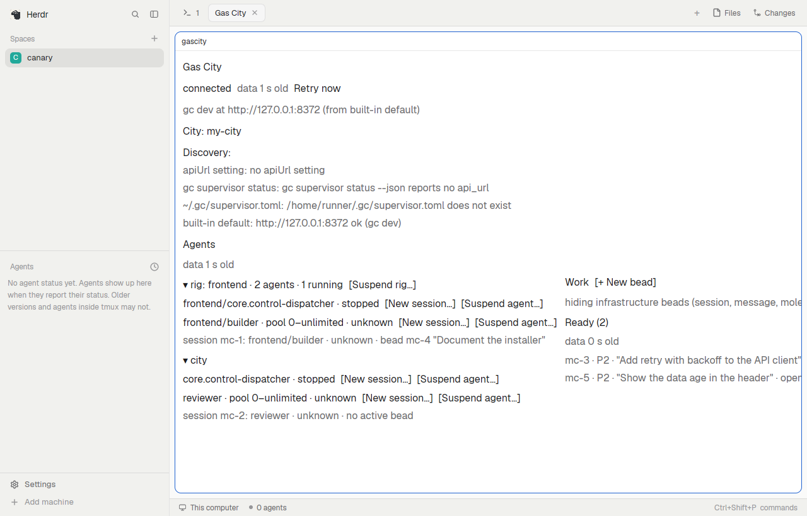

# Gas City

A tab that shows a [Gas City](https://github.com/gastownhall/gascity) city
running on this computer: its rigs, agents and sessions with live status,
which sessions need you, and the city's work (ready, in progress, recently
closed). You act on them from the tab, from keys or from `herdr-app do
gascity.<command>`: wake, suspend, stop or close a session, send it input,
answer its prompt, open its terminal in a herdr tab, create, sling, close and
reopen beads. A toast tells you when a session needs you and opens a small
"needs you" window on it. Every change goes through gc's HTTP API; gc stays
the only authority over its sessions.

## Before you add it

- **It reaches the network**, but only gc's API on this computer: loopback
  URLs (`127.0.0.1`, `localhost`, `[::1]`); any other URL is refused, not
  fetched.
- **It runs programs:** `<gc> supervisor status --json` (to find gc's API),
  and, when you click Open terminal, a herdr tab running `env -u HC_SCOPE -u
  HC_TERMINAL_ID -u HC_TERMINAL_SOCKET <gc> --city <path> session attach
  <id>`. `<gc>` is the shared `gascity.settings.gcBin`: `gc`, or the absolute
  path to a program named gc; nothing else is run. It never runs `hc`,
  `tmux` or `bd`.
- **It reads a file outside its folder:** `~/.gc/supervisor.toml` (the
  `[supervisor]` bind and port).
- **It writes** only `<app home>/data/gascity-probe/probe.json`, and only
  while the shared `gascity.probe` is `true` (a test aid; off by default).
- **Do not start gc from a herdr terminal.** herdr-core gives every program a
  terminal runs an `HC_SCOPE` token and kills every process carrying it (and
  their children) when the terminal's holder dies. A `gc start` or `gc
  supervisor start` typed into a herdr terminal hands that token to gc's
  controller and every agent session it starts, so a herdr crash would take
  the whole city down. Start gc from a terminal outside herdr, or as a
  service (`gc supervisor install`). The mod itself never starts a gc
  runtime: Open terminal wakes the session through gc's API first and drops
  those variables from the attach.
- **Needs** herdr-app 0.1.14 or newer, and a gc built from
  `gastownhall/gascity` main at or after commit `9ba215cb59` (2026-11-09):
  no gc release has every API call the mod uses yet. An older gc shows "gc
  too old (needs <operation>)" in the header. The exact versions are in
  `compat.json`.

## What you see

One pane (a tab named "Gas City" when the installer opens it), on the
theme's background and foreground colors, 12px padding, 8px between rows;
secondary text in the theme's muted color.

- **Title:** "Gas City", 16px semibold.
- **Header:** the connection chip (`connected`, `connecting`, `looking for
  gc`, `gc not reachable at <url> (<where the URL came from>)`,
  `reconnecting in N s (<cause>)`, `city stopped`, `gc too old (needs …)`,
  `read-only server`), "N need you", the data's age, and `Retry now` when
  there is something to retry. Below it: the API URL, gc's version and where
  the URL came from; `City: <name>`; the other cities with their state; a
  "Choose a city:" list when more than one city runs and none is chosen;
  "Discovery:" with each place gc's API was looked for and what it gave.
- **Agents** (left, takes the free width): one group per rig in gc's order,
  `▾ <rig> · <N> agents · <M> running` with `[Suspend rig…]`;
  then the city's own agents. Each agent row: name, pool limits, status,
  `[New session…]`, `[Suspend agent…]`/`[Resume agent]`; under it its
  sessions, `session <id>: <alias> · <status> · bead <id> "<title>"` (or
  "no active bead"), "terminal attached" when one is. Sessions no agent
  claims are under "Other sessions".
- **Work** (right): `Work [+ New bead]`, the filter note (which
  infrastructure bead types are hidden), then three columns: Ready (N),
  In progress (N), Recently closed (N). A card: `<id> · <priority> ·
  "<title>" · <state> · <type> · → <assignee> · [<labels>]`.
- **Detail** (below both, when a session or a bead is open): a session's
  status, facts, wake reasons, pending prompt with gc's own options as
  buttons, the last 40 lines of output, the send box (`[Send]`,
  `[Interrupt and send]`, `[Send as message]`) and its actions (`[Wake]`,
  `[Suspend]`, `[Stop turn]`, `[Pin]`/`[Unpin]`, `[Close…]`, `[Kill…]`,
  `[Open terminal]`); a bead's facts, description, close reason and
  `[Sling…]`, `[Close…]` or `[Reopen]`.
- **Activity:** one line per action and its outcome (`pending`, `done`,
  `failed`, `outcome unknown`) with `[Retry]` where a retry is safe.
- Buttons are bracketed words, `[Like this]`; a button whose action is under
  way reads `[<Action>: under way]`, muted.

## How it behaves

- **Status**, most specific first: needs you (a pending prompt, with its
  kind) > a lifecycle state other than active (suspended, asleep, …, with
  gc's reason) > the program's state > the transcript's activity, marked
  "(transcript)" > unknown. An agent row shows its most urgent session.
- **Live:** the city's events are read every 2 s while a Gas City pane is on
  screen (every 10 s while hidden), sessions every 5 s (30 s), everything
  every 60 s; each region says how old its data is and keeps
  stale data greyed under the error, never hidden.
- **Clicks:** a session row opens its detail (again: closes it); a card
  opens the bead; a rig heading collapses its group; destructive actions
  (Close, Kill, Suspend agent or rig, Close bead, sling) ask first.
- **Keys** (after `pane.go` onto the pane): `j`/`down` and `k`/`up` move
  between sessions, `r` retries now, `t` opens the open session's terminal,
  `escape` closes the open question or the detail.
- **Commands:** `herdr-app do gascity.<verb>:<args…>` (arguments
  percent-encoded, separated by `:`) reach every Gas City pane on screen;
  commands that change gc name their city first and run once per app. The
  full list is in the repository's README; the installer uses
  `set-gc-bin:<gc>`.
- **Needs you:** a new pending prompt posts a toast `<session> needs you`;
  clicking it opens the "needs you" window (`mod.open:gascity`, half the
  window's width, 60% of its height) on that session.
- **Open terminal** wakes the session through gc, waits until gc says it
  runs, then opens a tab `<agent>/<session>` running `gc session attach` in
  a space on this computer (or selects the one already open).

## Built from

- `mods/gascity/main.js`, one readable ES module built from TypeScript
  (`bun run build`); `mod.json`: `{"place":"none","title":"Gas City",
  "focusable":true,"overlay":{"kind":"window","key":"gascity","width":0.5,
  "height":0.6}}`. No art: text, the theme's colors and gpui-kit's `div`,
  `h_flex`, `v_flex` and `Input`.
- Props: none (the copy shows its last city, else the only running one), or
  `{"city": "<name>"}` to pin a copy to one city.
- `herdr` functions: `theme`, `props`, `shared`/`setShared`
  (`gascity.settings`, `gascity.probe`, `gascity.focus`, `gascity.window`),
  `localStorage`, `home`, `appHome`, `readTextFile`, `writeTextFile`,
  `exec` (gc only), `fetch` (loopback only), `panes`, `focused`, `layout`,
  `spaces`, `terminals`, `notify`, `nextCommand`, `closeOverlay`, and `run`
  with `tab.new`, `tab.select` and `mod.open` only.
- Programs: gc (above). Shipped mods: none.
- Optional `keys.json` fragment: `{"global": {"ctrl-alt-g":
  "mod.open:gascity"}}` (opens the "needs you" window from anywhere).

## Watch out

- herdr delivers `herdr-app do gascity.<cmd>` only to copies on screen; a
  hidden tab gets nothing. The installer shows the tab before it sends
  `set-gc-bin`, and retries until the new copy has loaded.
- A new mod is not docked on herdr's shipped layouts: open it with
  `herdr-app do tab.new --mod gascity --name "Gas City"` (the installer does),
  in a space on this computer.
- herdr gives async work to the copy that is running when it starts and
  never settles it once that copy closes: shared work starts only from a
  live copy's own timer, and every step has a deadline.
- A herdr-app started from the desktop may not have gc on its PATH: set
  `gcBin` to gc's absolute path (`--gc-bin` in the installer).
- A gc home other than `~/.gc` needs the `apiUrl` setting in
  `gascity.settings` (a mod cannot read environment variables).
- Limits: 50 cards per work column, 20 recently closed, 2 000 sessions,
  40 lines of output, 3 toasts per burst.

## Done when

- `herdr-app check mods/gascity` passes and `herdr-app status` lists no
  errors after `herdr-app do tab.new --mod gascity --name "Gas City"`.
- With a city running, the header says `connected`, the agents and work
  regions list what `gc` lists, and the data age stays under a few seconds
  while the tab is shown.
- With gc stopped, the header says `gc not reachable at …` and `Retry now`
  finds it again once gc is back.
- `herdr-app do gascity.refresh` is logged in the probe's `commands`
  (`herdr-app do gascity.probe:on`, then
  `<app home>/data/gascity-probe/probe.json`).
- Open terminal on a running session opens a tab attached to it; nothing it
  starts carries `HC_SCOPE`.
